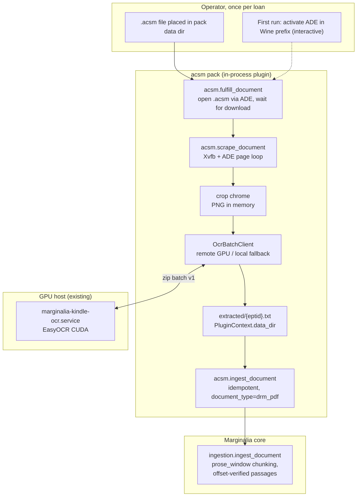

# Adobe-DRM PDF ingestion via Wine + ADE + OCR

**Status:** draft (2026-11-07). No code exists yet. The architecture is
fixed; the Wine/ADE specifics marked *(A#)* are **assumptions gated by the
Phase 0 feasibility spike** — nothing is built until the spike passes.
**Build guide:** [`docs/implementation/drm-pdf-ocr/build-guide.md`](../implementation/drm-pdf-ocr/build-guide.md).

## Goal

Ingest a book the operator holds as an Adobe-DRM loan — the `.acsm`
fulfillment file and the `*_encrypted.pdf`/EPUB that Adobe Digital Editions
(ADE) downloads — into the corpus by the same route the Kindle pack uses:
drive the authorized reader UI, capture each page, OCR it, cache the text,
and hand canonical text to core for chunking and verification.

## Relationship to existing boundaries

The reading-list acquisition design (landing separately) declares DRM out of
scope *for that script* — "no code path that reads an encrypted file" — and
reports such targets `needs_operator`. This pack **is** that operator route,
mechanized: it does
not circumvent DRM. The encrypted container is only ever opened by ADE
running under Wine on the operator's own machine, with the operator's own
Adobe activation, exactly as a human reader would — the pack automates
page-turns and screenshots the visible pages. Same licensed-content warning
and single-user posture as the Kindle pack. When both documents land, the
reading-list doc's non-goals should point here instead of stopping at
`needs_operator`.

The legal analysis behind the posture, stated so it can be reviewed rather
than asserted: the access control is never bypassed — decryption happens
inside ADE with a valid activation, and what the pack captures is exactly
what an authorized human reader sees on screen. Screenshotting one's own
authorized rendering for personal annotation is a different act from
extracting the underlying file; the doc's authors believe the former, not
the latter. This is a judgment call that varies by jurisdiction; the pack
ships with the warning prominent and treats redistribution as out of scope
by construction.

## Prior art: what is cloned from the Kindle pack

The Kindle pack (repo `John-Cusack/marginalia-plugin-kindle`) already solves
every stage after "get the text out of a rendering engine". The new pack
reuses its shape, tools, and — where separable — its code.

| Stage | Kindle pack | New pack |
|---|---|---|
| Get content into a renderer | Playwright → Kindle Cloud Reader | Wine → Adobe Digital Editions |
| Authentication | Amazon login, `CookieStore` cookie reuse | Adobe activation inside the Wine prefix (interactive first run, persisted by ADE itself) |
| Page navigation | JS scrubber events, last-page detection | `xdotool` right-arrow/PageDown keys, frame-hash end detection |
| Text extraction | DOM text first; OCR fallback for image pages | OCR only — ADE renders DRM pages as pixels; there is no DOM |
| Screenshot handling | PNG in memory, chrome cropped | Same: capture → fixed crop → bytes never touch disk |
| OCR | Local EasyOCR (GPU) + remote batch `OcrBatchClient`, circuit-breaker fallback | Same service and client, shared (see OCR decision) |
| Cache | `extracted/{asin}.txt` under `PluginContext.data_dir` | `extracted/{key}.txt` same layout |
| Ingest | `ingestion.find_existing(source=)` idempotency → `ingestion.ingest_document` with `document_type='kindle_book'` | Identical, with `document_type='drm_pdf'` |
| Operator tooling | `research-engine-kindle-setup` console script | `research-engine-acsm-setup` same pattern |

## Fixed decisions

Do not reopen these in implementation tickets:

| Concern | Decision |
|---|---|
| Pack | New repository `John-Cusack/marginalia-plugin-acsm`, distribution `marginalia-ai-plugin-acsm`, top-level package `acsm`, schema-v2 `plugin.yaml`, entry point `research_engine.plugins` — the standard five-pack shape |
| Reader | ADE 4.5.x pinned, installed once per Wine prefix by the operator, not by the pack. The pack verifies but never installs Windows software |
| Display | Dedicated `Xvfb` virtual display (e.g. `:9`, fixed 1280×900 to match Kindle's crop constants). ADE runs in a Wine virtual desktop on that display. Headless-safe, no host desktop interference |
| Input | `xdotool` key events to the ADE window. No image-recognition clicking; keys only (Right / PageDown), which ADE honors in reading view |
| Capture | X11 grab of the ADE content region (`import -window <id> png:-` or `xwd`+convert), streamed to stdout → PNG bytes in memory, cropped, straight to OCR. Nothing rendered is written to disk |
| OCR | Client code vendored from the Kindle pack (below); OCR service stays the existing `marginalia-kindle-ocr.service` on the GPU host |
| Identity | eptid from the fulfilled document's `rights.xml` (stable across renewals and devices); fallback SHA-256 of the encrypted file bytes when rights parsing fails |
| Document type | `drm_pdf`, `default_chunker: prose_window`, declared in the manifest |
| Automation ethics | No DRM circumvention, no credential scraping. ADE activation is a one-time interactive step the operator performs in the Wine prefix; the pack never touches Adobe credentials |

## OCR code reuse — the one real architectural decision

The Kindle pack's OCR client (`ocr_config.py`, `ocr_wire.py`,
`scraper/ocr.py`, `scraper/ocr_remote.py`) and its host side
(`ocr_server.py`, `ocr_control.py`, systemd unit, deploy/) are carefully
built: bounded PNG validation, zip wire protocol with version pinning,
health-check "warm on CUDA" gate, retry only on 502/503/504 + transport
errors, circuit-breaker to local OCR, never-partial ordering, no book text
in logs. Plugins cannot import other packs, and the SDK must stay
Torch-free, so there are three placements:

1. **Vendor-copy into the new pack.** Fastest; the ~500 client lines drift
   from the Kindle originals and two copies of the wire protocol must be
   kept in lockstep (protocol version is already enforced at runtime, so a
   drift fails loudly, but it still fails).
2. **Extract to a shared plain pip package** `marginalia-ai-ocr` (client +
   wire + config; not a plugin, no entry point), depended on by both
   `marginalia-ai-plugin-kindle` and `marginalia-ai-plugin-acsm`. Host-side
   (`ocr_server`, `ocr_control`, systemd) moves with it or stays in the
   Kindle repo as the service owner.
3. **Move into the SDK.** Rejected: pulls `httpx`+`PIL` into SDK for packs
   that never OCR, and OCR is consumer logic, not contract logic.

**Decision: option 1 — vendor now, extract on proof.** The Kindle pack is
the only proven consumer; making the extraction a prerequisite for ACSM
couples a working plugin to a hypothesis. Rule of three: a second consumer
does not justify a shared package, it justifies *waiting for one that
works*. The wire protocol already defends itself at runtime — the version
handshake in `ocr_wire` means a drifted copy fails loudly, never silently.
The extraction trigger is the first non-copy change (bug fix or feature)
the vendored copy needs, or ACSM's first successful release, whichever
comes first. Hard rule while vendored: **any wire-protocol change is made
in both copies in one change set, with the version gate bumped in both** —
never amend the protocol in one pack alone.

## Phase 0 — feasibility spike (gate before any pack code)

Every Wine/ADE specific above is an assumption until proven. The spike is
shell scripts and a throwaway notebook — no pack code, no abstractions —
and it exists to kill the project cheaply if an assumption is wrong:

| # | Assumption | Test | Kill criterion |
|---|---|---|---|
| A1 | ADE 4.5.x installs and renders correctly under a pinned Wine on Xvfb | Install, launch, open a library document | ADE renders blank on Xvfb or needs a real compositor/GPU |
| A2 | Keyboard-only paging works | `xdotool` Right/PageDown; compare consecutive frame hashes | Paging needs focus/mouse tricks that don't survive automation |
| A3 | Window-grab + crop OCRs acceptably | Run ~10 pages through the existing OCR service; word error rate against known text | WER high enough to corrupt meaning without a realistic fix |
| A4 | eptid is extractable from `rights.xml` | Parse a fulfilled container | No stable identity field → fall back to file hash (weaker; documented) |
| A5 | Activation survives the automation context | Activate once in the prefix, relaunch headless, open without re-auth | ADE demands re-activation per session → the loop is unusable |

Record results here with the exact pinned Wine/ADE versions. **If A1 or A2
fails, the architecture changes at one seam and only one:** the renderer
host becomes a headless Windows VM (RDP/VNC capture replaces X11 grab,
SendKeys replaces xdotool). `capture.py` and `driver.py` are the named
seams for exactly this reason — everything downstream of the PNG bytes is
host-agnostic.

## Architecture



## Components

### Pack layout

Mirrors the Kindle pack exactly:

```
acsm/
  plugin.yaml            # permissions: subprocess, filesystem(read_write_plugin_data), ingest; network only if remote OCR
  _paths.py              # data_dir-derived paths via PluginContext
  _acquire.py            # shared drive-and-capture helper (the _scrape.py analogue)
  fulfill.py             # ADE launch, .acsm open, download wait, rights.xml eptid parse
  driver.py              # page loop: focus, keypress, settle, capture, hash, detect end
  capture.py             # Xvfb lifecycle, window lookup, X11 grab, fixed crop
  ocr_client.py …        # vendored copy of the Kindle OCR client (see OCR decision)
  tools/
    fulfill_document.py  # .acsm → ADE library, returns eptid + cached file path
    scrape_document.py   # drive + OCR → extracted text on disk
    ingest_document.py   # scrape-if-needed + ingestion.ingest_document
    check_document.py    # on disk? / in corpus?
    list_documents.py
```

### `research-engine-acsm-setup` console script

Pattern for kindle §7, no automatic installs:

1. verify `wine`, ADE executable in the prefix, `Xvfb`, `xdotool`,
   ImageMagick `import`, Tesseract;
2. report OCR status (local EasyOCR / remote endpoint / shared package
   version);
3. offer to launch ADE interactively on the operator's display for Adobe
   activation — the operator does the activation, the script only opens the
   window;
4. print a one-document smoke-test command.

Never reads Adobe credentials; never runs `winetricks` implicitly.

### Fulfillment (`fulfill.py`)

- Copy the `.acsm` into the pack data dir, invoke
  `wine C:\\...\\DigitalEditions.exe <acsm>` on the Xvfb display.
- ADE downloads and stores the encrypted document in its library. Wait by
  polling ADE's library directory for a new PDF/EPUB and for the ADE process
  to go idle; timeout with an actionable error.
- Parse `rights.xml` (inside the fulfilled container) for the eptid; on
  failure use SHA-256 of the file. This key is the ASIN-analogue for every
  downstream idempotency check and cache path.
- Renewals: ADE loans expire. If the container is already fulfilled and
  cached text exists, the pack never re-opens ADE — the cache is the record.
  Re-fulfill only on explicit `force_rescrape`.

### The Wine prefix is operator state

- The prefix (ADE install + activation) is created once by the operator;
  the pack verifies it and otherwise touches it only through ADE itself.
- Document backup/restore: copy the prefix before any ADE upgrade. Adobe
  activations are scarce (see Risks); a burnt activation is not recoverable
  by the pack.
- Pin 96 DPI and no UI scaling in the prefix. Crop constants in
  `capture.py` and OCR legibility both depend on it; `research-engine-acsm-setup`
  asserts both and refuses to run a scrape against a misconfigured prefix.
- Keep the prefix outside any repo checkout; it holds licensed content.

### Page loop (`driver.py`)

The Kindle loop's state machine, minus DOM extraction:

1. Launch ADE on Xvfb, open the document, wait for first render (fixed
   settle delay + non-blank frame heuristic — mirror the
   `_KRYPTONITE_WARMUP_MS` pattern; a blank/still-initializing frame is
   detected by near-uniform pixel variance, not by timeout alone). ADE
   reopens at its last-read position, like KCR does — the go-to-start
   problem is the same shape and gets the same answer: an explicit
   beginning affordance (Ctrl+Home / go-to-page), verified by the
   non-blank heuristic, never reliance on the opener's position.
2. Capture frame → crop fixed chrome (window decoration, left library
   sidebar, toolbar — constants measured per ADE version and asserted by a
   setup-time screenshot diff) → OCR → append text, record frame SHA-256.
3. Send Right-arrow via `xdotool`, sleep `page_delay ∈ [min, max]` (same
   jitter defaults 1.5–4.0 s), capture again.
4. Frame hash equals previous → the turn didn't register or we're at the
   end. Retry the keypress up to N times; if the hash stays equal for
   `max_consecutive_stale` turns (default 4) *and* OCR text is empty for
   `max_consecutive_empty` (default 20, same semantics as Kindle's
   photo-insert guard), declare end-of-document.
   A page-count estimate from ADE's page indicator (top-left region OCR) is
   a cross-check when present, never authoritative.
5. Stall watchdog: if no frame change and no OCR progress for
   `stall_timeout` (default 120 s), kill the ADE process, relaunch, reopen
   the document, and continue from the last stable page index. ADE freezing
   mid-session is the expected failure mode, not the exceptional one.

Duplicate-page risk (keypress lost → same page OCR'd twice) is bounded by
step 4's hash check; missed-page risk (turn registered but content changed
before capture) is bounded only by the settle delay — chosen generously
because ADE has no progress API to verify against.

### Capture (`capture.py`)

- `Xvfb :9 -screen 0 1280x900x24` started per scrape, torn down after.
- Window lookup by `xdotool search --name "Adobe Digital Editions"`;
  capture the *window*, not the root, so crop constants are relative to
  ADE's own frame, not the desktop.
- Capture bytes → `PIL` crop → PNG bytes in memory → page image in the
  zip batch. Same `MAX_IMAGE_PIXELS` / `MAX_BYTES` / `MAX_PAGES` bounds.

### Cache and ingest (`tools/ingest_document.py`)

Line-for-line the Kindle tool with s/asin/eptid/:

- `ingestion.find_existing(source=str(text_path.resolve()))` for
  idempotency; `force_reingest` for re-chunking;
- reuse cached `extracted/{eptid}.txt` unless `force_rescrape`;
- metadata: `title` (from ADE library metadata or the .acsm), `page_count`,
  `source`, `eptid`; write `metadata["edition_key"]` when the operator
  supplies one (e.g. the print ISBN), so `work_verify` edition checks work
  — this matters more than for Kindle, because DRM loans are perishable and
  the edition is the durable citation target;
- `ingestion.ingest_document(text=full_text, document_type="drm_pdf", …)`;
  core chunks with the manifest-declared `prose_window` and validates
  offsets, keeping quotes verifiable against the canonical cached text.

**Cross-source duplication is owned, not ignored.** A book ingested via
Kindle *and* via ACSM produces two corpus documents. That is accepted:
`edition_key` is the join key citations resolve through, the two texts
differ legitimately (different pagination, different transcription
fidelity), and corpus-level dedup/merging is a core concern out of scope
for this pack — but the doc records the decision so nobody "fixes" it by
deduping silently inside the pack.

## Tool surface (manifest sketch)

| Tool | Purpose |
|---|---|
| `acsm.fulfill_document` | `.acsm` path → fulfilled container + eptid. Interactive ADE launch |
| `acsm.scrape_document` | Drive + OCR + cache. Args: `acsm_path` or `eptid`, `page_delay_min/max`, `max_pages`, `max_consecutive_empty`, `max_consecutive_stale`, `force_rescrape` |
| `acsm.ingest_document` | Scrape-if-needed + ingest. Adds `force_reingest`, `edition_key` |
| `acsm.check_document` | Fulfilled? cached? ingested? by `acsm_path` or `eptid` |
| `acsm.list_documents` | Cached + ingested join |

`acsm.fulfill_document` is the one tool with no Kindle analogue and the only
one that must be allowed to raise "operator action required" (activation
missing, ADE not installed, loan expired).

## Permissions and security notes

- `subprocess: true` here is a bigger grant than Kindle's: the subprocess is
  Wine running Windows code (ADE), not a managed Chromium. Document this in
  the manifest comments; the operator approves the pack knowing ADE runs
  with the user's privileges. The pack itself never shells out with
  interpolated strings — fixed argv lists, host alias validated like
  `KINDLE_OCR_SSH_TARGET`.
- `network: egress` only when a remote OCR endpoint is configured (same
  empty-allowlist posture as Kindle: no fixed GPU host in the pack).
- Rendered page images are license-restricted content: keep the Kindle
  rule — PNG bytes in memory only, never logged, never written to disk;
  only OCR text is persisted, under plugin data.
- Xvfb lifetime is bounded to a single scrape; no persistent X server from
  the pack.

## Transcription integrity — OCR errors become canon

Kindle treats OCR as a fallback; DOM text is ground truth. Here OCR is the
only path, and that collides with the corpus's core promise: `verify_quote`
and claim anchors check quotations against the stored canonical text, so a
mis-recognized word is verified against itself. A quote of the OCR error
reports `exact`. The system's verification machinery cannot catch this
failure class; only capture quality and review can.

Mitigations, in order of leverage:

1. **Capture quality is the cheapest accuracy lever.** The spike's A3 gate
   compares legibility across DPI/render settings; if ADE scales with DPI,
   pin 96 in the prefix; if legibility is poor, grow the Xvfb surface —
   pixels are cheap, retries are not.
2. **Record a per-page quality signal.** Implemented as a text-quality proxy,
   not OCR confidence: the zip wire protocol returns text only, so the pack
   records the printable-character ratio (`quality_min`/`quality_mean`,
   `suspect_pages`) with the metric named in the sidecar. It finds symbol-soup
   recognition; chrome contamination is the crop probe's job. Adding a real
   confidence channel would mean changing the shared protocol and the sibling
   pack — deliberately not done for this release (see the pack's research D11).
3. **Honest review posture.** `scrape_document` marks the cache
   `reviewed: false`; `ingest_document` proceeds anyway (same posture as
   Kindle, whose OCR fallback pages are equally unverified), but
   `acsm.check_document` surfaces unreviewed caches. Spot-checking a sample
   is operator work — stated, not hidden.
4. **`edition_key` is the ultimate ground truth.** Citations resolve to the
   print edition; the OCR'd text is the corpus's reading copy, not the
   authority.

## Alternatives considered and rejected

| Alternative | Why rejected |
|---|---|
| DRM-removal tooling (adobekey/DeDRM-class) | Actual circumvention of an access control. Legal exposure, and against the project's stated posture. Not considered further. |
| Processing the encrypted container directly | Only ADE's engine can decrypt it — same objection as above. |
| Headless Windows VM as renderer host | Viable; heavier (VM lifecycle, licensing, capture-over-RDP quality). Designated fallback if spike A1/A2 fails — not the plan. |
| Reusing the YourCloudLibrary route | Different channel: YCL covers its lendable catalog; this pack covers operator-owned `.acsm` loans from any storefront. No overlap to exploit. |

## Failure modes

| Failure | Detection | Response |
|---|---|---|
| ADE not activated | Fulfill opens a login dialog; window-title heuristic | `operator_action_required` error naming `research-engine-acsm-setup` |
| ADE freeze / crash | Watchdog: no frame hash change, no OCR progress | Kill + relaunch + resume from last stable page |
| Lost keypress | Consecutive identical frame hash | Re-send key, bounded retries, then stale-streak end detection |
| Loan expired mid-scrape | ADE error dialog (title match) / sudden blank frames | Abort with actionable error; cached pages kept, scrape marked partial |
| OCR host outage | Existing circuit breaker | Local fallback, same as Kindle |
| Duplicate/missing pages | Frame-hash log + page-count cross-check | Report `page_count` confidence in scrape result; never silently claim completeness |

## Testing strategy

- **Unit:** driver state machine with an injectable frame source (scripted
  frame-hash sequences: normal run, lost keypress, end-of-book, ADE stall
  → resume); eptid/rights.xml parsing on fixture containers; crop
  constants against a fixture ADE screenshot; ingest idempotency mirrors
  the Kindle `test_ingest_book.py` shape against the SDK ingestion client.
- **Vendored OCR client:** run the Kindle `test_ocr_offload.py` suite
  against the vendored copy at import time in CI (same fixtures, switched
  import path), so both copies stay protocol-identical until extraction.
- **Integration:** one end-to-end test against a fixture PDF shown in a
  stub "reader" window on Xvfb (an ImageMagick slideshow driving the same
  xdotool path) — proves the X11 automation plumbing without ADE.
- **Operator smoke (not CI):** real `.acsm` → fulfill → scrape → ingest on
  the actual Wine prefix. DRM cannot be simulated honestly; keep this as a
  documented manual gate, like the Kindle release smoke.

## Risks

- **ADE-under-Wine fragility** is the load-bearing assumption: window
  titles, focus behavior, and key handling vary by Wine version. Mitigate
  by pinning ADE + Wine versions in `research-engine-acsm-setup` output and
  keeping all selectors in `capture.py`/`driver.py` so a version bump is a
  constants change, not a logic change.
- **Activation limits:** Adobe limits activations per account (historically
  6 devices). Frequent prefix rebuilds can burn them; the setup script
  surfaces "deactivate before deleting a prefix" guidance.
- **Perishable source:** loans expire; the cache is the only durable
  artifact. This is why `edition_key` at ingest and honest `page_count`
  confidence reporting matter more here than in the Kindle path.
- **Legal posture:** the pack must ship with the same licensed-content
  warning as Kindle, prominent in README and in `fulfill_document`'s
  response metadata. It is a personal-use accessibility/annotation tool;
  redistribution of captured text or images is out of scope by construction.
