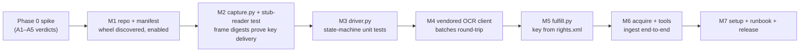

# Building the ACSM pack — implementation guide

**Repository to create:** `John-Cusack/marginalia-plugin-acsm`
**Distribution:** `marginalia-ai-plugin-acsm` · **Import package:** `acsm`
**Read first:** [`docs/design/drm-pdf-ocr-ingestion-architecture.md`](../../design/drm-pdf-ocr-ingestion-architecture.md)
— this guide implements that design; it does not re-argue it.
**Reference implementation:** `John-Cusack/marginalia-plugin-kindle` (clone the shape,
swap the driver).

## 0. Deliverable

A schema-v2 plugin wheel that, once installed, approved and enabled, contributes
five MCP tools and one document type to core:

| Deliverable | Definition of done |
|---|---|
| `acsm.fulfill_document` | `.acsm` path → fulfilled container in ADE's library → stable document key (`eptid` or SHA-256) |
| `acsm.scrape_document` | Drives ADE on a private Xvfb display, OCRs every page, writes `extracted/{key}.txt` + `{key}.json` sidecar |
| `acsm.ingest_document` | Idempotent `ingestion.ingest_document(document_type="drm_pdf")`; reuses the cache |
| `acsm.check_document` | Reports fulfilled / cached / ingested / `reviewed` |
| `acsm.list_documents` | Cached ∪ ingested, joined on key |
| `document_types: drm_pdf` | `default_chunker: prose_window`; core chunks and offset-validates the text |
| `research-engine-acsm-setup` | Verifies wine/ADE/Xvfb/xdotool/import/tesseract; never installs, never takes credentials |

Non-goals: no DRM circumvention, no credential handling, no automatic ADE/Windows
installation, no EPUB-specific pagination work, no OCR-accuracy guarantee.

## 1. Phase 0 spike — the gate (do this before writing any pack code)

Shell and throwaway scripts only. Assumptions are numbered as in the design doc;
record each verdict (with the exact Wine and ADE versions) in the design doc's
table before proceeding.

```bash
# A1 — does ADE render under pinned Wine on a private display?
export WINEPREFIX=~/.local/share/acsm/wineprefix
wine --version                      # pin this exact version in acsm_setup output
Xvfb :9 -screen 0 1280x900x24 &
DISPLAY=:9 matchbox-window-manager &     # needed: XTEST key delivery wants input focus
DISPLAY=:9 wine "$WINEPREFIX/drive_c/Program Files/Adobe/Digital Editions/DigitalEditions.exe" &
# then: open a fulfilled document by hand, screenshot, look at it
DISPLAY=:9 import -window root /tmp/ade.png

# A2 — do keys page the document?
DISPLAY=:9 xdotool search --onlyvisible --name "Adobe Digital Editions"
DISPLAY=:9 xdotool windowactivate --sync <id> && DISPLAY=:9 xdotool key --clearmodifiers Right
# compare consecutive frame captures; if nothing changes, try:
DISPLAY=:9 xdotool key --window <id> Next      # XSendEvent path, needs no focus
# Record which one works. This decides driver.py's key sender.

# A3 — is the OCR quality acceptable?
# Run ~10 captured pages through the existing OCR service, diff against known text.
curl -s "$KINDLE_OCR_BASE_URL/health"          # must report warm + cuda

# A4 — where is the eptid?
unzip -p /path/to/fulfilled.epub META-INF/rights.xml | head -40
# (PDF: pdftotext is useless here — inspect the raw XML stream for the same block)

# A5 — does activation survive a headless relaunch?
DISPLAY=:9 wine DigitalEditions.exe            # reopen without re-authenticating
```

**Kill/redirect criteria.** A1 or A2 fails → stop; the renderer host becomes a
headless Windows VM and only `capture.py`/`driver.py` change. A3 fails → the
project is an "assist the operator" tool (page images + manual transcription),
not an ingestion pack — take that decision explicitly, not by shipping bad text.
A4 fails → file-hash identity; everything else is unaffected.

Record A3 as a number (word error rate on the sample). It is the input to §5.4's
quality gate.

## 2. Repository bootstrap

```
marginalia-plugin-acsm/
  pyproject.toml
  LICENSE  README.md  CHANGELOG.md
  acsm/
    __init__.py          # empty, like kindle/__init__.py — no import side effects
    plugin.yaml
    _paths.py            # data-dir paths
    capture.py           # Xvfb + window + grab + crop
    driver.py            # page loop state machine
    fulfill.py           # wine/ADE + container + eptid
    acquire.py           # orchestration: drive → OCR → cache
    ocr_config.py        # vendored from kindle (see §3.4)
    ocr_wire.py          # vendored
    ocr_local.py         # vendored from kindle/scraper/ocr.py
    ocr_remote.py        # vendored from kindle/scraper/ocr_remote.py
    setup.py             # research-engine-acsm-setup logic
    tools/
      __init__.py
      fulfill_document.py  scrape_document.py  ingest_document.py
      check_document.py    list_documents.py
  tests/
    unit/  integration/
```

`pyproject.toml` — copy the Kindle one and change three lines:

```toml
[project]
name = "marginalia-ai-plugin-acsm"
version = "0.1.0"
description = "Adobe-DRM (ACSM/ADE) page-capture and ingestion plugin for Research Engine"
requires-python = ">=3.11"
license = "Apache-2.0"
dependencies = [
    "pillow>=10.0",
    "httpx>=0.27",
    "structlog>=24.0",
    "marginalia-ai-sdk>=0.6.1,<1",
]
# No playwright, no pytesseract, no easyocr: ADE is the renderer and the OCR
# service is remote. Local EasyOCR stays optional for laptop-only use.
[project.optional-dependencies]
gpu-ocr = ["easyocr==1.7.2"]
dev = ["pytest>=8.0", "pytest-asyncio>=0.23", "ruff>=0.5", "marginalia-ai>=0.6.2,<1"]

[project.entry-points."research_engine.plugins"]
acsm = "acsm"

[project.scripts]
research-engine-acsm-setup = "acsm.setup:main"

[tool.hatch.build.targets.wheel]
packages = ["acsm"]
```

`acsm/plugin.yaml`:

```yaml
schema_version: 2
plugin_id: acsm

requires:
  core_api: ">=0.6,<0.7"
  python: ">=3.11"

permissions:
  # egress is needed only when a remote OCR endpoint is configured; there is no
  # fixed host, so the allowlist is empty by design (same posture as Kindle).
  network: egress
  network_allowlist: []
  # wine, Xvfb, xdotool, import run as subprocesses. Operator note: this grants
  # execution of Adobe Digital Editions under Wine with the user's privileges.
  subprocess: true
  filesystem: read_write_plugin_data
  ingest: true

provides:
  document_types:
    - id: drm_pdf
      default_chunker: prose_window

  mcp_tools:
    - id: acsm.fulfill_document
      entry: acsm.tools.fulfill_document:handler
      description: >-
        Open an .acsm fulfillment file with Adobe Digital Editions under Wine and
        return the fulfilled container's stable key. Requires an activated prefix;
        activation is performed once, interactively, by the operator.
      input_schema:
        type: object
        properties:
          acsm_path: {type: string, description: "Path to the .acsm file."}
          force_refill: {type: boolean, default: false}
        required: [acsm_path]
    - id: acsm.scrape_document
      entry: acsm.tools.scrape_document:handler
      description: >-
        Page through a fulfilled document in Adobe Digital Editions on a private
        Xvfb display, OCR every page, and cache the text. Does NOT ingest into the
        corpus — use acsm.ingest_document for that.
      input_schema:
        type: object
        properties:
          document_key: {type: string}
          page_delay_min: {type: number, default: 1.5}
          page_delay_max: {type: number, default: 4.0}
          max_pages: {type: [integer, "null"], default: null}
          max_consecutive_stale: {type: integer, default: 4}
          max_consecutive_empty: {type: integer, default: 20}
          force_rescrape: {type: boolean, default: false}
        required: [document_key]
    - id: acsm.ingest_document
      entry: acsm.tools.ingest_document:handler
      description: >-
        Scrape (if needed) and ingest a fulfilled document as document_type
        'drm_pdf'. Idempotent: returns the existing document_id when the same
        source path has already been ingested.
      input_schema:
        type: object
        properties:
          document_key: {type: string}
          title: {type: string, description: "Override the title read from ADE."}
          edition_key: {type: string, description: "e.g. the print ISBN."}
          reviewed: {type: boolean, default: false}
          force_rescrape: {type: boolean, default: false}
          force_reingest: {type: boolean, default: false}
        required: [document_key]
    - id: acsm.check_document
      entry: acsm.tools.check_document:handler
      description: >-
        Report fulfillment, cache, review and corpus state for one document key.
      input_schema:
        type: object
        properties:
          document_key: {type: string}
          acsm_path: {type: string}
      anyOf: [{required: [document_key]}, {required: [acsm_path]}]
    - id: acsm.list_documents
      entry: acsm.tools.list_documents:handler
      description: List documents known to the plugin, joining cache and corpus.
      input_schema:
        type: object
        properties:
          include_ingested: {type: boolean, default: true}
```

Two manifest rules the SDK enforces: models are `extra="forbid"`, so no invented
keys; and every `entry` must live inside the `acsm` package (enforced by
`PluginLoader._import_entry`). Keep the tool `input_schema` here byte-identical to
the `@tool(...)` decorator — `tests/integration/test_built_wheel.py` holds the two
equal, as it does for Kindle.

## 3. Modules, in build order

Dependency order is bottom-up: paths → capture → driver → OCR → fulfill →
acquire → tools. Each module below is independently unit-testable with no X
server, no Wine, and no OCR service.

### 3.1 `_paths.py`

Mutable state goes under the injected `PluginContext.data_dir`
(`~/.research-engine/plugin-data/acsm`), never a hard-coded home path.

```python
from pathlib import Path

def inbox_dir(data_dir: Path) -> Path:      # staged .acsm copies
    return data_dir / "inbox"

def extracted_dir(data_dir: Path) -> Path:
    return data_dir / "extracted"

def text_path_for(data_dir: Path, key: str) -> Path:
    return extracted_dir(data_dir) / f"{key}.txt"

def sidecar_path_for(data_dir: Path, key: str) -> Path:
    return extracted_dir(data_dir) / f"{key}.json"
```

The Wine prefix is **operator state**, not plugin data — it holds licensed
content and an activation. Keep it outside `data_dir` (e.g.
`~/.local/share/acsm/wineprefix`) and expose its location through one setting so
`acsm_setup` and `fulfill.py` cannot disagree about it.

### 3.2 `capture.py`

Owns the display, the window, and the pixels. Everything here is Phase-0-pinned
constants; the module should read like a table of measurements with code around it.

```python
DISPLAY = ":9"
SCREEN = "1280x900x24"
WM = "matchbox-window-manager"
ADE_TITLE = "Adobe Digital Editions"          # A1: verify, pin per ADE version
CROP = (0, 44, 1280, 860)                     # (l, t, r, b) — A3: measured once
BLANK_STDDEV = 3.0                            # near-uniform ⇒ not rendered yet

class Display:
    """Private Xvfb + minimal WM. Context manager; never left running."""

    async def __aenter__(self): ...   # Xvfb, wait for /tmp/.X11-unix/X9, then WM
    async def __aexit__(self, *exc): ...  # terminate WM, then Xvfb

async def find_ade_window(display: str) -> str:
    # xdotool search --onlyvisible --name <ADE_TITLE>; error if 0 or >1 matches

async def grab_png(display: str, window_id: str) -> bytes:
    # import -window <window_id> png:-   (stdout → bytes; nothing touches disk)

def crop_png(png: bytes, box: tuple[int, int, int, int]) -> bytes: ...
def frame_digest(png: bytes) -> str:      # sha256 of the *cropped* pixels
def is_blank(png: bytes) -> bool:         # PIL ImageStat.stddev < BLANK_STDDEV
```

Invariants: fixed argv lists, `shell=False`, `DISPLAY` passed via `env` (never
string-interpolated); a window is grabbed, never the root, so `CROP` is relative
to ADE's own frame; PNG bytes are returned, never written.

`import -window <id>` needs ImageMagick; if it is unavailable on the operator's
host, fall back to `xwd -id <id> | convert xwd:- png:-`. Detect once in
`acsm_setup` and store the chosen command — do not try both at runtime.

### 3.3 `driver.py`

The page loop. **All I/O is injected** — that is what makes it unit-testable:

```python
@dataclass(frozen=True)
class PageCapture:
    index: int
    png: bytes
    digest: str

@dataclass
class DriveResult:
    pages: list[PageCapture]
    ended_by: str          # "stale" | "empty" | "max_pages" | "last_page"
    restarts: int

async def drive_document(
    *,
    window_id: str,
    capture: Callable[[int], Awaitable[bytes]],   # index -> cropped PNG
    send_turn: Callable[[], Awaitable[None]],     # Right / PageDown
    send_start: Callable[[], Awaitable[None]],    # Ctrl+Home / go-to-page 1
    page_delay_min: float = 1.5,
    page_delay_max: float = 4.0,
    max_pages: int | None = None,
    max_consecutive_stale: int = 4,
    max_consecutive_empty: int = 20,
    stall_timeout: float = 120.0,
    on_restart: Callable[[], Awaitable[str]] | None = None,  # -> new window_id
    sleep: Callable[[float], Awaitable[None]] = asyncio.sleep,
) -> DriveResult: ...
```

Loop contract, in the order the checks must run:

1. `send_start()`; poll `capture()` until `not is_blank(...)` or the settle
   timeout expires. ADE reopens at its last-read position like KCR does — never
   trust the opener's position.
2. Capture → `frame_digest`. Digest equals previous ⇒ the turn did not register:
   re-send up to `max_consecutive_stale` times. Exhausted ⇒ `ended_by="stale"`.
3. OCR text empty/duplicate for `max_consecutive_empty` consecutive pages ⇒
   `ended_by="empty"` (mirrors Kindle's photo-insert and stuck-page guard; the
   two counters are *not* the same test and must not be merged).
4. No digest change and no new text for `stall_timeout` ⇒ call `on_restart()`
   (kills and relaunches ADE, returns the fresh window id) and continue; ADE
   freezing mid-document is the expected failure case. Increment `restarts`;
   abandon after 3.
5. `max_pages` (or the A2 last-page affordance, when one was found) terminates.

Jitter the delay per turn in `[page_delay_min, page_delay_max]`; a fixed cadence
makes the "turn registered but content not repainted" race more likely, not less.

### 3.4 `ocr_*` — the vendored client

Copy four files, then change exactly three things:

| Copy | From (`marginalia-plugin-kindle`) | Change |
|---|---|---|
| `acsm/ocr_config.py` | `kindle/ocr_config.py` | add `VENDORED_FROM = "<commit sha>"` |
| `acsm/ocr_wire.py` | `kindle/ocr_wire.py` | none (`PROTOCOL = 1` unchanged) |
| `acsm/ocr_local.py` | `kindle/scraper/ocr.py` | import path only |
| `acsm/ocr_remote.py` | `kindle/scraper/ocr_remote.py` | import path only |

Keep the `KINDLE_OCR_*` environment variable names. They configure the shared
service, and two sets of names for one service is the drift you would be trying
to avoid. Rename them only if and when the extraction into a shared distribution
happens (design doc, "OCR code reuse").

Add a sync-guard unit test — cheap and it protects the one thing vendoring gets
wrong:

```python
def test_vendored_protocol_matches_upstream():
    from acsm.ocr_wire import PROTOCOL as ours
    from kindle.ocr_wire import PROTOCOL as upstream   # dev extra only
    assert ours == upstream
```

Mark it `pytest.importorskip("kindle")` so the pack's own CI does not require the
Kindle wheel.

### 3.5 `fulfill.py`

```python
@dataclass(frozen=True)
class Fulfilled:
    key: str            # eptid, else sha256 of the container
    container: Path     # the encrypted PDF/EPUB in ADE's library
    title: str

async def fulfill(acsm_path: Path, *, settings, display: Display) -> Fulfilled: ...
def extract_eptid(container: Path) -> str | None: ...
def document_key(container: Path) -> str: ...   # eptid or sha256
```

- Launch: `wine <DigitalEditions.exe> <acsm_path>` with `DISPLAY` and
  `WINEPREFIX` in `env`, fixed argv.
- The fulfilled container lands in ADE's library directory inside the prefix;
  wait by polling for a new `*.pdf`/`*.epub` **and** the ADE process going idle,
  with a bounded timeout and an actionable error on expiry.
- `extract_eptid` parses `META-INF/rights.xml` from the container (A4). Treat a
  miss as normal, not exceptional: fall back to `sha256` of the container bytes
  and say so in the result (`"key_source": "sha256"`), so the operator knows the
  identity is file-scoped and breaks on re-download.
- Loan expiry shows up here as an ADE dialog rather than a new file. Detect by
  window title before the timeout expires and return
  `{"status": "operator_action_required", ...}` — the tool is allowed to say that;
  the Kindle tools' reflex of returning `{"status": "error"}` for everything is
  not good enough when the fix is one human action.

### 3.6 `acquire.py`

The `_scrape.py` analogue: one async function that turns a key into cached text.
Serial flow, batched OCR, atomic cache write.

```python
async def scrape_to_disk(
    key: str, container: Path, *, settings: OcrSettings, data_dir: Path,
    page_delay_min=1.5, page_delay_max=4.0, max_pages=None,
    max_consecutive_stale=4, max_consecutive_empty=20,
) -> dict[str, Any]:
    """Returns {title, page_count, chars, confidence, output_path, ended_by}."""
```

- Open the display, find the ADE window, `drive_document(...)`.
- Feed pages to `OcrBatchClient.recognize()` in batches of
  `settings.batch_size` (≤16 pages / ≤32 MiB — the wire limits), preserving
  order. The client already falls back whole-batch to local OCR and opens the
  circuit once; do not re-implement that here.
- Collect per-page confidence from the OCR results; store `min` and `mean` in the
  sidecar. A page below a configured floor is listed by key in the sidecar's
  `low_confidence_pages` — the only cheap signal that a capture, not the model,
  went wrong.
- Write `extracted/{key}.txt` and `{key}.json` via `tmp` + `os.replace` so a
  crash never leaves a half-written cache (Kindle's plain `write_text` is fine
  there because a bad cache is detected downstream; here it would be ingested).
- On zero text: write nothing, return `page_count` and `ended_by` so the caller
  can tell "ADE never rendered" from "OCR failed" from "empty document".

Sidecar `{key}.json` shape:

```json
{
  "key": "…", "key_source": "eptid|sha256",
  "title": "…", "container": "/path/to/encrypted.pdf",
  "page_count": 312, "ended_by": "stale", "restarts": 1,
  "ocr": {"model": "english_g2", "protocol": 1, "remote": true,
          "confidence_min": 0.41, "confidence_mean": 0.93,
          "low_confidence_pages": [17, 88]},
  "reviewed": false,
  "scraped_at": "2026-11-07T12:00:00+00:00",
  "ade_version": "4.5.x", "wine_version": "…"
}
```

### 3.7 `tools/`

Five handlers, Kindle's shape with the key swapped. Client injection is by
parameter name (`research_engine.mcp.dispatch._select_clients`): declare
`context=None, ingestion=None` and they arrive; anything else goes in `**_clients`.

`acsm.ingest_document` is the one worth writing out:

```python
@tool(id="acsm.ingest_document", description=..., input_schema={...})
async def handler(
    document_key: str,
    title: str | None = None,
    edition_key: str | None = None,
    reviewed: bool = False,
    force_rescrape: bool = False,
    force_reingest: bool = False,
    context=None, ingestion=None, **_clients,
) -> dict:
    if ingestion is None:
        return {"status": "error", "error_type": "config",
                "message": "Ingestion unavailable; the plugin needs permissions.ingest=true."}

    text_path = text_path_for(context.data_dir, document_key)
    source = str(text_path.resolve())

    if not force_reingest:
        existing = await ingestion.find_existing(source=source)
        if existing:
            return {"status": "already_ingested", "document_id": existing[0]["document_id"],
                    "document": existing[0]}

    sidecar = read_sidecar(context.data_dir, document_key)
    if force_rescrape or not text_path.exists():
        scraped = await scrape_to_disk(document_key, container_for(context, document_key),
                                       settings=OcrSettings.from_env(), data_dir=context.data_dir)
        if not scraped["text"].strip():
            return {"status": "error", "error_type": "empty_text",
                    "message": f"No text captured (ended_by={scraped['ended_by']}).",
                    "page_count": scraped["page_count"]}
        sidecar = scraped
    else:
        scraped = {"text": text_path.read_text(encoding="utf-8"), **sidecar}

    metadata = {
        "acsm_key": document_key,
        "key_source": sidecar.get("key_source", "unknown"),
        "container": sidecar.get("container"),
        "page_count": sidecar.get("page_count"),
        "ocr": sidecar.get("ocr"),
        "reviewed": reviewed,
        "source_format": "adobe_drm",
    }
    if edition_key:
        metadata["edition_key"] = edition_key      # citations resolve through this

    result = await ingestion.ingest_document(
        title=title or sidecar.get("title") or f"Untitled ({document_key[:8]})",
        document_type="drm_pdf",
        text=scraped["text"],
        source=source,
        metadata=metadata,
        language="en",
    )
    return {"status": "success", "document_key": document_key, "source": source,
            "chars": len(scraped["text"]), "page_count": sidecar.get("page_count"),
            "ocr": sidecar.get("ocr"), **result}
```

Notes:

- `read_sidecar(data_dir, key)` and `container_for(context, key)` are thin helpers
  in `_paths.py`/`fulfill.py`: the first loads `{key}.json`, the second resolves
  the fulfilled container path recorded in it (with the ADE library as a rebuild
  fallback when the sidecar is missing). Neither may raise on absence — a missing
  sidecar means "scrape first", not an error.
- Hand core the **entire** canonical text; core resolves `prose_window` from the
  manifest and validates every passage offset against it. Never pre-chunk.
- `find_existing(source=...)` is the idempotency key. Pass the resolved absolute
  path, exactly as the cache writer wrote it.
- `reviewed` is passed through rather than enforced: the corpus's posture (set by
  Kindle) is to ingest unverified OCR text and surface it. Do not silently flip
  this to `True`.
- `acsm.check_document` is where `reviewed: false` and `low_confidence_pages`
  become visible. It should return them at the top level, not buried in metadata.

### 3.8 `setup.py` and the console script

Kindle's §7 pattern, no implicit actions:

1. Probe and print: `wine --version`, `WINEPREFIX` existence, ADE executable
   presence, `Xvfb`, `matchbox-window-manager`, `xdotool`, `import`/`convert`,
   `tesseract`, local `easyocr` (optional), and the remote OCR `/health` verdict.
2. Print the exact commands for anything missing. Install nothing.
3. `--activate`: start the display, launch ADE on the *operator's* display (not
   headless) so the operator can complete Adobe activation. Relaunch headless
   afterwards and assert A5 (no re-activation prompt) — this is the check that
   saves an activation slot.
4. `--capture-probe`: launch ADE on a fulfilled document, take one frame per
   page-turn attempt, print frame digests. This is how `CROP` and the key-sender
   choice get re-measured after an ADE or Wine upgrade, without touching the pack.
5. `--backup-prefix` / `--restore-prefix`: tar/untar the prefix with an explicit
   confirmation and a refuse-on-conflict rule, like Kindle's data migration.

## 4. Tests

Mirror Kindle's two-tier split; nothing in `tests/unit` may need X, Wine, or the
OCR service.

| Test | Proves |
|---|---|
| `test_driver_state_machine.py` | Scripted frame/hash sequences: normal run; lost keypress → stale retries → `ended_by="stale"`; empty run → `ended_by="empty"`; stall → `on_restart` called, resume continues; `max_pages` honoured. Injected `capture`/`send_turn`/`on_restart`, no X |
| `test_capture_crop.py` | `CROP` against a fixture ADE screenshot; `is_blank` on a blank vs rendered fixture; `frame_digest` stability |
| `test_fulfill_key.py` | `extract_eptid` on fixture `rights.xml`; sha256 fallback on a container without it; `key_source` reported |
| `test_ingest_document.py` | Kindle's `_FakeIngestion` pattern: already-ingested short-circuits without scraping; ingests with text on disk; `force_reingest` skips the lookup; unavailable `ingestion` returns a config error; empty text returns `empty_text` |
| `test_paths.py` | Paths derive from `context.data_dir`; no home-directory literal |
| `test_ocr_offload.py` (copied) | Vendored client: batch order, fallback-on-failure, circuit opening, protocol mismatch, settings validation |
| `test_vendored_protocol.py` | `PROTOCOL` matches upstream (skipped if Kindle absent) |
| `tests/integration/test_built_wheel.py` | Wheel is discovered, declared permissions match what the tools use, exactly five tools listed, `acsm.check_document` callable and schema-validated, manifest `input_schema` == decorator schema |
| `tests/integration/test_stub_reader.py` | End-to-end X11 plumbing **without ADE**: an ImageMagick slideshow of a fixture PDF on the display, driven by the real `xdotool` sender and real `capture.py` |

The stub-reader test is the one that pays for itself: it separates "our X11
automation is wrong" from "ADE is being ADE", which is otherwise the single most
expensive ambiguity in this project.

## 5. Operator runbook (README content)

1. `pip install marginalia-ai-plugin-acsm` (or `pipx`); `research-engine plugin audit acsm`
   → `plugin enable acsm --yes`.
2. Build the prefix: install Wine, create `WINEPREFIX`, install ADE 4.5.x
   manually, then `research-engine-acsm-setup --activate`.
3. Pin DPI 96 and disable UI scaling in the prefix; `acsm_setup` asserts both.
4. `acsm.fulfill_document` with the `.acsm` path.
5. `acsm.scrape_document` with the returned key; inspect `page_count`,
   `ended_by`, `confidence_min` and `low_confidence_pages` before trusting it.
6. `acsm.ingest_document` with `edition_key` set to the print ISBN.
7. Back up the prefix (`--backup-prefix`) before any ADE upgrade; deactivate
   before deleting a prefix.

Include the licensed-content warning verbatim from Kindle's README, plus: the
pack automates a reader you are authorized on; it does not remove DRM; captured
images are never written to disk; the OCR text is a reading copy, not an
authoritative edition.

## 6. Release and CI

- CI: Python 3.11–3.13; `ruff check acsm tests`; `pytest tests/unit -q`;
  `uv build`; `twine check --strict`; wheel content assertions (package,
  `plugin.yaml`, `py.typed`-equivalents, entry point); an integration job
  installing `marginalia-ai` + the SDK and running the wheel contract tests.
- Not in CI: anything needing ADE, Wine, or X. The stub-reader test runs
  headless with `Xvfb` available on the runner; skip with a clear reason if the
  runner lacks it rather than silently passing.
- Release gate: install from a built wheel into a clean venv, enable, run
  `acsm.check_document`, and complete one real `.acsm` smoke per release notes
  (like Kindle's, this is a documented manual gate — DRM cannot be faked).

## 7. Build order and milestones



| Milestone | Done when |
|---|---|
| M1 | Wheel installs, `plugin audit acsm` lists the five tools and one document type with no import of `acsm`; `plugin enable` registers them |
| M2 | `capture.py` grabs a frame from a stub reader window on Xvfb; crop and blank detection asserted against fixtures |
| M3 | Driver state machine passes the scripted sequences with no X server in the process |
| M4 | Vendored client passes the copied OCR suite; protocol guard passes with Kindle installed |
| M5 | `.acsm` fulfills on a real prefix; key is `eptid` on at least one real document, fallback exercised in tests |
| M6 | One real book scrapes, caches, and ingests; re-running `ingest_document` returns `already_ingested`; `verify_quote` resolves a known-good quotation against the ingested text |
| M7 | Setup script reports a complete environment from cold; README runbook reproducible by someone who has never seen the repo |

If M5's real-document check cannot be run (no library loan available yet), say so
in the release notes and ship M1–M4 — the pack is inert until enabled, and a
documented gap beats a fabricated "verified".

## 8. Two things that will bite

- **Focus, not keys, is the failure mode.** XTEST key delivery goes to whatever
  holds input focus; a bare Xvfb has no window manager, so focus is undefined and
  keys vanish. Run a minimal WM. If A2 shows XSendEvent (`xdotool key --window`)
  works reliably for ADE, prefer it — it needs no focus at all.
- **`CROP` is version-fragile.** Any ADE or Wine upgrade can move chrome by a few
  pixels; a stale crop puts the toolbar into the OCR text of every page. Assert
  the crop in `acsm_setup --capture-probe` against a known page and fail loudly
  when the digest of the first page changes between runs.
